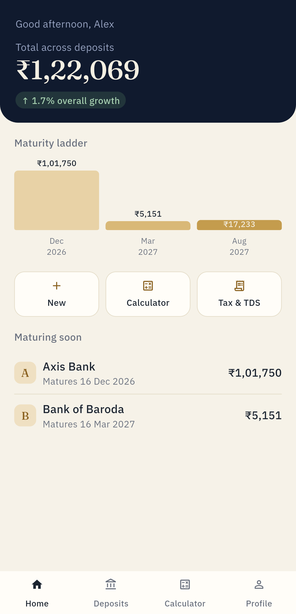
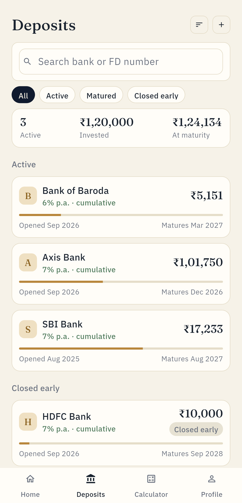
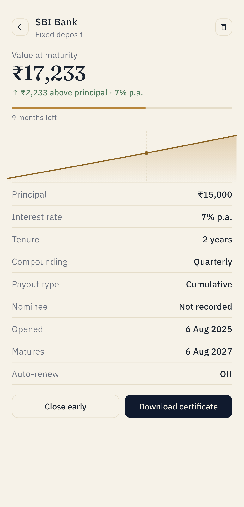
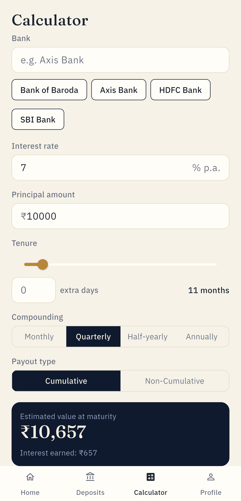
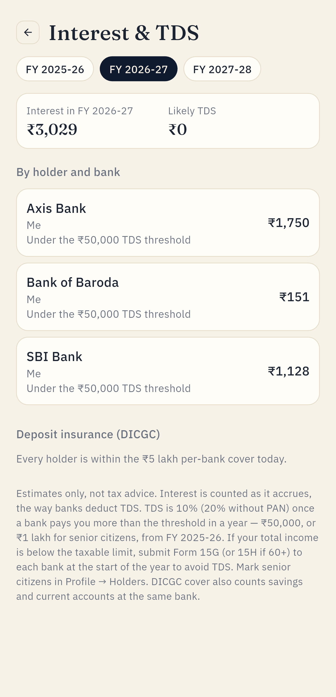
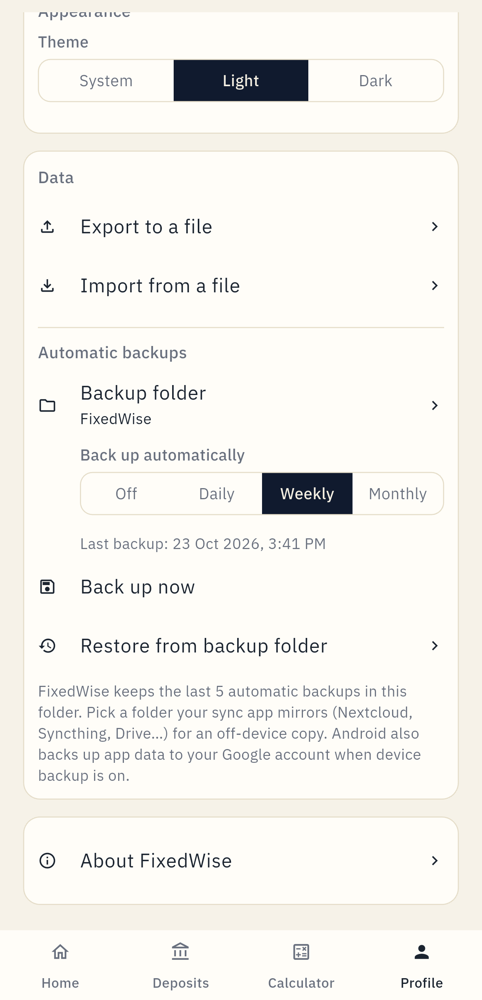
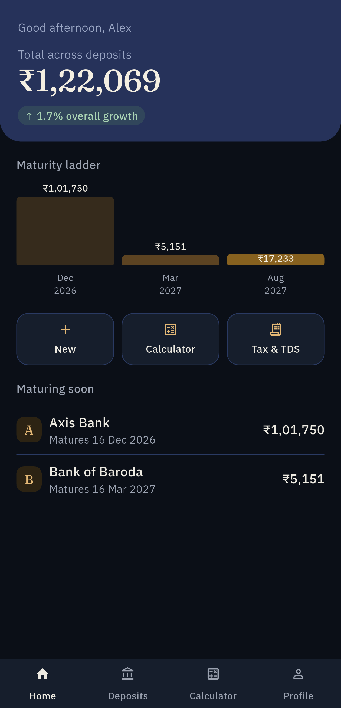

<div align="center">


# FixedWise

**A private, offline Fixed Deposit tracker and calculator built for India.**

Track every FD across your family, see what's maturing next, get reminded before it does,
and know how much interest each person earns per financial year — with TDS and DICGC checks.

[](https://github.com/SarveshP16/FixedWise/releases/latest)
[](LICENSE)


[**Website**](https://sarveshp16.github.io/FixedWise/) · [**Download APK**](https://github.com/SarveshP16/FixedWise/releases/latest) · [Features](#features) · [Getting started](#getting-started) · [Privacy](#privacy--permissions) · [Build from source](#build-from-source)

<a href="https://ko-fi.com/crystaxit"></a>

</div>

---

## Screenshots

<table>
  <tr>
    <td></td>
    <td></td>
    <td></td>
    <td></td>
  </tr>
  <tr>
    <td align="center"><sub>Dashboard</sub></td>
    <td align="center"><sub>All deposits</sub></td>
    <td align="center"><sub>Deposit detail</sub></td>
    <td align="center"><sub>Calculator</sub></td>
  </tr>
  <tr>
    <td></td>
    <td></td>
    <td></td>
    <td></td>
  </tr>
  <tr>
    <td align="center"><sub>Interest &amp; TDS</sub></td>
    <td align="center"><sub>Automatic backups</sub></td>
    <td align="center"><sub>Dark theme</sub></td>
    <td></td>
  </tr>
</table>

## Features

### Track every deposit
- **All your family's FDs in one place.** Tag each deposit to a *holder* (you, a parent, a spouse…) and filter by them.
- **Dashboard** with your total, a **maturity ladder** of what's coming up, and a *maturing soon* list.
- **Reminders** a few days before each FD matures (you choose how many).
- **Renew** a matured FD in one tap, or **close early** and record what the bank actually paid.
- Search, sort and filter by Active / Matured / Closed early.

### Calculated the way Indian banks do it
- **Cumulative or non-cumulative** (monthly, quarterly, half-yearly or annual payout).
- **Tenures in months and days** — 444 days, 1 year 15 days, 7 days to 10 years.
- **Bank-accurate interest**: whole compounding periods, then simple interest on the leftover days; plain simple interest for FDs under 6 months.
- **Correct maturity dates**: 31 January + 1 month is 28 February, not 3 March.
- **Premature closure** with the bank's penalty (0.5% below ₹5 lakh, 1% above — editable).
- **Tax-saver FDs (Section 80C)** with their 5-year lock-in enforced.
- **Nominee** per deposit, and Indian number formatting everywhere (₹12,34,567).

### Tax & safety
- **Interest per financial year** (April–March), per holder and per bank — what goes into your ITR under *Income from other sources*.
- **TDS estimate** per bank under Section 194A: ₹50,000 threshold, ₹1,00,000 for **senior citizens** (FY 2025-26 onwards).
- **DICGC check**: a warning when one person has more than the ₹5 lakh insurance cover at a single bank.

### Private by design
- **No internet permission. No ads, no trackers, no account, no server.**
- **App lock** with a 6-digit PIN or fingerprint; escalating lockout after wrong guesses; screenshots and the recent-apps preview are blocked while locked.
- **Automatic backups** (daily / weekly / monthly) to any folder you pick, keeping the last 5 — point it at a Syncthing or Nextcloud folder for an off-device copy. Plus manual export/import, and Android's own device backup.
- **Light and dark themes**, following your system by default.

## Download

| Where | Notes |
| --- | --- |
| [**GitHub Releases**](https://github.com/SarveshP16/FixedWise/releases/latest) | Signed APK for all Android phones (7.0 and up). Each release lists the file's SHA-256 so you can verify it. |
| **F-Droid** | Submission in progress. |

> **Heads-up:** F-Droid signs apps with its own key. Once FixedWise is on F-Droid you can't update a GitHub-installed copy from F-Droid (or vice versa) without reinstalling — export a backup first.

## Getting started

1. **Install** the APK and open FixedWise. No sign-up — it's ready immediately.
2. **Add a deposit** with the **+** button: pick the bank, enter the rate, amount, tenure (months + extra days) and the date you opened it. The panel at the bottom shows the maturity value as you type.
3. **Add family members** in **Profile → Holders**, and tap the person-with-cane icon to mark anyone aged 60+ as a senior citizen (it changes their TDS threshold).
4. **Turn on automatic backups** in **Profile → Automatic backups → Backup folder**. Create a folder such as `Documents/FixedWise` and allow access. FixedWise backs up straight away, then weekly by default.
5. **Check your tax picture** any time from **Tax & TDS** on the dashboard.
6. *(Optional)* **Lock the app** in **Profile → Security → App lock**.

**Moving to a new phone:** copy the newest `fixedwise-auto-….json` from your backup folder, install FixedWise on the new phone, then use **Profile → Import from a file**.

## How interest is calculated

| Case | Formula |
| --- | --- |
| Cumulative, 6 months or longer | `P × (1 + r/n)^k × (1 + r × d/365)` — *k* complete compounding periods, then simple interest on the remaining *d* days |
| Cumulative, under 6 months | `P × (1 + r × days/365)` — simple interest |
| Non-cumulative (payout) | `P × r / n` paid every period; principal returned at maturity |
| Closed early | `P × (1 + (r − penalty) × days held/365)` — or the exact amount you enter |

*r* = annual rate, *n* = compounding periods a year (12, 4, 2 or 1). All figures are estimates to help you plan — your bank's statement is the final word. See [`maturity_calculator.dart`](lib/core/calculations/maturity_calculator.dart) and [`india_tax.dart`](lib/core/calculations/india_tax.dart).

## Privacy & permissions

FixedWise stores everything on your phone in a local database. Nothing leaves the device unless *you* export a backup or have Android device backup turned on.

| Permission | Why |
| --- | --- |
| Notifications, exact alarms, run at startup | Maturity reminders, re-scheduled after a reboot |
| Biometric | Optional fingerprint unlock for the app lock |
| *(none for storage)* | Backups use Android's folder picker, so the app only sees the one folder you choose |
| *(no internet)* | The app cannot send anything anywhere |

## Build from source

Requirements: [Flutter](https://docs.flutter.dev/get-started/install) 3.47 (stable) and the Android SDK.

```
git clone https://github.com/SarveshP16/FixedWise.git
cd FixedWise
flutter pub get
flutter test
flutter build apk --release
```

The APK lands in `build/app/outputs/flutter-apk/`. Release builds are signed with `android/key.properties` and the keystore it points to (both gitignored); without them, release builds fall back to the debug key.

<details>
<summary>Project layout</summary>

```
lib/
  core/
    backup/         folder backups, Auto Backup, JSON export/import
    calculations/   maturity_calculator.dart, india_tax.dart (pure, unit-tested)
    notifications/  maturity reminders
    security/       PIN, biometric, app-lock gate
    theme/          colours and type (Fraunces + IBM Plex Sans, bundled)
  features/
    dashboard/  deposits/  calculator/  holders/  tax/  profile/
test/             unit and widget tests
fastlane/         store listing and screenshots (used by F-Droid)
fdroid/           draft F-Droid build recipe
```

Stack: Flutter, `flutter_riverpod`, `go_router`, Hive. Every dependency is open source.

</details>

<details>
<summary>Windows note</summary>

If the repo lives on a different drive from your pub cache or Android SDK, Kotlin's incremental compiler can crash mid-build; `android/gradle.properties` already sets `kotlin.incremental=false` to avoid it.

</details>

## Roadmap

Ideas that are planned but not built yet include Form 15G/15H tracking, a "PAN linked" flag per holder, password-protected backups, and editing an existing deposit. Bug reports and pull requests are welcome in [Issues](https://github.com/SarveshP16/FixedWise/issues).

## Support

FixedWise is free, has no ads, and never will. If it helps you, you can buy me a coffee:

<a href="https://ko-fi.com/crystaxit"></a>

## Disclaimer

FixedWise gives estimates to help you plan. It is not financial or tax advice; always confirm figures with your bank and a tax professional.

## License

[GNU GPL v3.0](LICENSE). Bundled fonts (Fraunces, IBM Plex Sans) are under the SIL Open Font License 1.1 — see `assets/fonts/`.
